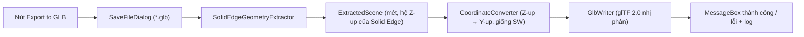

# Synode Exporter cho Siemens Solid Edge 2026

COM add-in (.NET Framework 4.8, x64) thêm nút **Export to GLB** vào Solid Edge 2026. Nút này xuất Part, Sheet Metal hoặc Assembly đang mở sang file `.glb` (glTF 2.0). Định dạng đầu ra tương đương plugin SOLIDWORKS (`solidworks-export-plugin`, lệnh `ExportGlbCommand`).

> Thư mục này độc lập với `nx_plugin` (plugin Siemens NX) và không dùng SOLIDWORKS API. Plugin SOLIDWORKS chỉ được các test **đọc** mã nguồn để so sánh kết quả.

## 1. Cấu trúc

```text
solid_plugin/
├── src/                                  Add-in (SynodeExporter.SolidEdge.dll)
│   ├── SynodeExporter.SolidEdge.csproj   net48, x64, tham chiếu interop chính thức trong "Solid Edge 2026\Program"
│   ├── AddIn/
│   │   ├── SynodeAddIn.cs                ISolidEdgeAddIn: OnConnection / OnConnectToEnvironment / OnDisconnection, tạo nút ribbon
│   │   ├── ExportGlbCommand.cs           Hộp thoại lưu file → đọc mô hình → chuyển tọa độ → ghi GLB → thông báo
│   │   ├── SolidEdgeGeometryExtractor.cs Duyệt Part/Assembly, tessellation Face.GetFacetData, ma trận Occurrence, FaceStyle
│   │   ├── SolidEdgeIds.cs               CLSID, ProgId, CATID môi trường
│   │   └── Logger.cs                     %LOCALAPPDATA%\SynodeExporter\SolidEdge\logs\SynodeSolidEdge.log
│   └── Core/                             Không phụ thuộc Solid Edge (được unit test)
│       ├── SceneModel.cs                 ExtractedScene/Node/Mesh/Material, ExportOptions, CoordinateConverter (giống SW)
│       ├── MeshAccumulator.cs            Gộp đỉnh trùng, loại tam giác suy biến, FacetReader
│       ├── Matrix.cs                     Mat4, chuyển ma trận Solid Edge → glTF
│       ├── Materials.cs                  Chuyển màu/độ trong suốt → PBR
│       ├── GlbWriter.cs                  Ghi GLB (cho ra byte giống hệt SharpGLTF 1.0.6 mà plugin SW dùng)
│       └── Json.cs                       Ghi JSON (định dạng số shortest round-trip giống System.Text.Json)
├── tests/
│   ├── run_tests.ps1                     Build và chạy test net48 + net9.0
│   └── SynodeExporter.Tests/             Test runner dạng console (không cần NuGet)
├── scripts/
│   ├── Test-Environment.ps1              Kiểm tra Solid Edge 2026, interop, .NET 4.8, x64, SDK (chỉ đọc)
│   ├── New-IconResource.ps1              Sinh icon ribbon RT_BITMAP 101 (20×20) và 102 (32×32)
│   ├── RegistryLayout.ps1                Danh sách khóa registry dùng chung cho install/uninstall
│   └── Test-ScriptSyntax.ps1             Kiểm tra mọi *.ps1: có UTF-8 BOM và PowerShell Parser không báo lỗi
├── build.ps1
├── install.ps1
├── uninstall.ps1
└── README.md
```

## 2. Luồng export



| Nội dung | Cách làm |
|---|---|
| Đơn vị | API Solid Edge trả về **mét**, cũng là đơn vị của glTF, nên `UnitScale = 1` (giống mặc định của SW). |
| Part / Sheet Metal | Node gốc mang tên tài liệu. Mesh lấy từ các body đang hiển thị (`Body.Visible`). |
| Assembly | Node gốc là assembly. Cây node được dựng theo `Occurrences` và duyệt sub-assembly đệ quy. Transform cục bộ lấy từ `Occurrence.GetMatrix` (bố cục ma trận được xác định khi chạy). Linh kiện dùng nhiều lần có nhiều node riêng, mỗi node một transform. |
| Hình học | `Face.GetFacetData(tolerance)` cho vertex và normal. Chord tolerance tính theo đường chéo body (giống công thức của SW). Đỉnh trùng được gộp, tam giác suy biến bị loại. |
| Vật liệu | Màu lấy theo thứ tự FaceStyle của face → body → base style của part (`GetDiffuse`, `Opacity`). Tạo mesh `<node>_Material_<i>` cho mỗi nhóm vật liệu như SW. Metallic và roughness bằng 0 vì FaceStyle không có PBR. |
| GLB | Một buffer duy nhất. Index là uint16 hoặc uint32 tùy số đỉnh. Có min/max của accessor. Bỏ qua node hoặc mesh rỗng. Không bao giờ ghi hình học giả. |

## 3. Yêu cầu

- Windows 64-bit, **Solid Edge 2026** (Edge.exe 226.x, đã kiểm tra trên 226.00.01.004).
- .NET Framework 4.8 trở lên (Release ≥ 528040).
- Để build: .NET SDK (đã thử với 9.0.305) và Reference Assemblies .NET Framework 4.8.
- Để chạy test so sánh byte-đối-byte: thư mục `..\..\solidworks-export-plugin` (đọc mã nguồn `Export\*.cs` và `packages\SharpGLTF.*.1.0.6`).

Kiểm tra môi trường (không thay đổi hệ thống):

```powershell
powershell -ExecutionPolicy Bypass -File .\scripts\Test-Environment.ps1 -RequireSdk
```

## 4. Build và test

```powershell
cd C:\plugin_export_3d\siesmen-export-plugin\solid_plugin
powershell -ExecutionPolicy Bypass -File .\build.ps1          # build + test, DLL ra .\dist
powershell -ExecutionPolicy Bypass -File .\build.ps1 -SkipTests
powershell -ExecutionPolicy Bypass -File .\tests\run_tests.ps1 # chỉ chạy test
```

`build.ps1` thực hiện các bước sau:

1. Kiểm tra môi trường.
2. Sinh icon.
3. Build trên bản sao nguồn trong `%TEMP%\SynodeSolidEdgeBuild`.
4. Chép `SynodeExporter.SolidEdge.dll` vào `dist\`.
5. Kiểm tra DLL là **x64 (Amd64)**.
6. Chạy test.

Interop của Solid Edge **không** được copy vì Edge.exe tự nạp bản chính thức trong thư mục `Program`.

**Kết quả test gần nhất:**

| Bộ test | Runtime | Kết quả |
|---|---|---|
| net48 | .NET Framework 4.8.9363 x64 (cùng CLR với Edge.exe) | **34/34 PASS** |
| net9.0 | .NET 9.0.9 x64 | **59/59 PASS** |

Bộ test net9.0 kiểm tra những điểm sau:

- 12 scene mẫu (part, nested assembly, 65535/65536 đỉnh, vật liệu, tên Unicode/emoji, …) cho ra GLB **giống từng byte** với `CoordinateConverter` + `GltfSceneWriter` gốc của plugin SW (SharpGLTF 1.0.6). Chỉ chuỗi `asset.generator` khác nhau.
- 300.000 số float/double ngẫu nhiên được định dạng giống System.Text.Json.
- GLB do net48 sinh ra giống hệt bản net9.

## 5. Cài đặt (đăng ký COM, cần xác nhận)

> [!WARNING]
> Các script `.ps1` có chuỗi tiếng Việt nên **bắt buộc lưu ở dạng UTF-8 with BOM**. Windows PowerShell 5.1 đọc file không có BOM theo bảng mã ANSI (cp1252). Khi đó một số byte UTF-8 (ví dụ `0x93` trong chữ "ồ") bị hiểu thành dấu nháy kép và gây ParserError. Sau khi sửa file, hãy chạy `.\scripts\Test-ScriptSyntax.ps1` để kiểm tra.

> [!IMPORTANT]
> `install.ps1` ghi registry. Script in ra toàn bộ khóa sẽ ghi và hỏi **Y/N** trước khi ghi. Nó chỉ ghi CLSID `{42B484DA-1593-41C3-9623-1BFAA4DA645C}` và ProgId `SynodeExporter.SolidEdge.AddIn`, không động đến add-in khác, license hay cấu hình Siemens.

```powershell
# Mở "Windows PowerShell" (x64) bằng Run as administrator
cd C:\plugin_export_3d\siesmen-export-plugin\solid_plugin
powershell -ExecutionPolicy Bypass -File .\install.ps1 -DryRun   # chỉ xem trước
powershell -ExecutionPolicy Bypass -File .\install.ps1           # ghi HKLM (mặc định)
```

| Tham số | Ý nghĩa |
|---|---|
| `-DllPath` | Mặc định là `dist\SynodeExporter.SolidEdge.dll`. CodeBase trỏ thẳng vào file này, vì vậy không được di chuyển hay xóa DLL. |
| `-Scope Machine` hoặc `-Scope CurrentUser` | `Machine` (HKLM, cần admin) là cách đã được xác minh khớp với các add-in Siemens. `CurrentUser` (HKCU) chưa được kiểm chứng với Add-In Manager. |
| `-Force` | Bỏ qua câu hỏi xác nhận và kiểm tra xung đột CodeBase. |
| `-DryRun` | Chỉ in ra danh sách khóa. |

Các khóa được ghi (view 64-bit) nằm dưới `SOFTWARE\Classes\CLSID\{42B484DA-…}`:

- `409 = Synode Exporter`: tên hiển thị trong Add-In Manager.
- `AutoConnect = 1`.
- `Summary\409`: mô tả.
- `Implemented Categories`: Solid Edge Add-In `{26B1D2D1-…}` và .NET `{62C8FE65-…}`.
- `Environment Categories`: Part, Sync Part, Sheet Metal, Sync Sheet Metal, Assembly, Sync Assembly.
- `InprocServer32` (mscoree.dll, Class, Assembly, RuntimeVersion v4.0.30319, CodeBase).
- `ProgId`.

## 6. Sử dụng

1. Mở **Solid Edge 2026**, vào **Tools → Add-Ins → Add-In Manager**. Mục **☑ Synode Exporter** phải xuất hiện. Bỏ dấu tích để tắt add-in, tích lại để bật.
2. Mở một file Part (`.par`), Sheet Metal (`.psm`) hoặc Assembly (`.asm`).
3. Trên ribbon, bấm **Export to GLB** (tab/nhóm *Synode Exporter*). Chọn nơi lưu file `.glb`.
4. Một thông báo **GLB exported successfully** sẽ hiện ra kèm đường dẫn. Nếu có face hoặc linh kiện không xuất được, thông báo sẽ cảnh báo kèm đường dẫn log. Khi có lỗi, hộp thoại lỗi hiển thị nội dung lỗi.
5. Log nằm ở `%LOCALAPPDATA%\SynodeExporter\SolidEdge\logs\SynodeSolidEdge.log`.

## 7. Gỡ cài đặt

```powershell
powershell -ExecutionPolicy Bypass -File .\uninstall.ps1 -DryRun
powershell -ExecutionPolicy Bypass -File .\uninstall.ps1        # HKLM + HKCU, hỏi Y/N
```

Script chỉ xóa 2 khóa của Synode (CLSID và ProgId). File DLL được giữ nguyên.

## 8. Giới hạn đã biết

- Linh kiện bị suppress hoặc chưa nạp chỉ được nhận diện khi `OccurrenceDocument` bằng null. Những linh kiện này bị bỏ qua và ghi log.
- Màu ghi đè ở cấp occurrence (trong assembly) chưa được đọc. Màu được lấy từ style của part, body hoặc face.
- Translation được nhân với `UnitScale` khi `UnitScale ≠ 1`. Plugin SW không làm như vậy, nhưng add-in luôn dùng 1 nên không ảnh hưởng thực tế.
- Bố cục ma trận của `Occurrence.GetMatrix` được xác định khi chạy, dựa vào một occurrence có tịnh tiến khác 0.
- Vị trí nút trên ribbon và hiển thị icon phụ thuộc Solid Edge. Hai điểm này cần kiểm tra trực quan.

## 9. Trạng thái kiểm chứng

| Hạng mục | Trạng thái |
|---|---|
| Build add-in net48 x64, có nhúng icon RT_BITMAP 101/102 | ĐÃ KIỂM TRA |
| Lớp COM: GUID, ProgId, ComVisible, cài đặt `ISolidEdgeAddIn`, tạo instance | ĐÃ KIỂM TRA (bằng reflection, ngoài Solid Edge) |
| GLB writer và chuyển tọa độ (34 + 59 test, giống từng byte với writer của SW) | ĐÃ KIỂM TRA |
| install/uninstall `-DryRun` | ĐÃ KIỂM TRA |
| Ghi registry, hiển thị trong Add-In Manager, nút ribbon, export từ mô hình thật trong Solid Edge | CẦN KIỂM TRA THỦ CÔNG (xem mục 6) |
