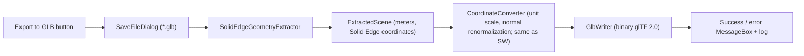

# Synode Exporter for Siemens Solid Edge 2026

A COM add-in (.NET Framework 4.8, x64) that adds an **Export to GLB** button to Solid Edge 2026. The button exports the open Part, Sheet Metal or Assembly document to a `.glb` file (glTF 2.0). The output format is equivalent to the SOLIDWORKS plugin (`solidworks-export-plugin`, `ExportGlbCommand` command).

> This folder is independent of `nx_plugin` (the Siemens NX plugin) and does not use the SOLIDWORKS API.

## 1. Structure

```text
solid_plugin/
├── src/                                  Add-in (SynodeExporter.SolidEdge.dll)
│   ├── SynodeExporter.SolidEdge.csproj   net48, x64, references the official interop assemblies in "Solid Edge 2026\Program"
│   ├── Properties/AssemblyInfo.cs        Assembly attributes (ComVisible(false) by default)
│   ├── AddIn/
│   │   ├── SynodeAddIn.cs                ISolidEdgeAddIn: OnConnection / OnConnectToEnvironment / OnDisconnection, creates the ribbon button
│   │   ├── ExportGlbCommand.cs           Save dialog → read model → convert coordinates → write GLB → notify
│   │   ├── SolidEdgeGeometryExtractor.cs Traverses Part/Assembly, Face.GetFacetData tessellation, Occurrence matrices, FaceStyle
│   │   ├── SolidEdgeIds.cs               CLSID, ProgId, environment CATIDs
│   │   └── Logger.cs                     %LOCALAPPDATA%\SynodeExporter\SolidEdge\logs\SynodeSolidEdge.log
│   └── Core/                             No Solid Edge dependency
│       ├── SceneModel.cs                 ExtractedScene/Node/Mesh/Material, ExportOptions (same as SW)
│       ├── MeshAccumulator.cs            Merges duplicate vertices, drops degenerate triangles, FacetReader
│       ├── Matrix.cs                     Mat4, Solid Edge → glTF matrix conversion
│       ├── Materials.cs                  Color/transparency → PBR conversion, CoordinateConverter (same as SW)
│       ├── GlbWriter.cs                  GLB writer (produces bytes identical to SharpGLTF 1.0.6 used by the SW plugin)
│       └── Json.cs                       JSON writer (shortest round-trip number formatting, same as System.Text.Json)
├── scripts/
│   ├── Test-Environment.ps1              Checks Solid Edge 2026, interop assemblies, .NET 4.8, x64, SDK (read-only)
│   ├── New-IconResource.ps1              Generates the ribbon icons RT_BITMAP 101 (20×20) and 102 (32×32)
│   ├── RegistryLayout.ps1                Registry key list shared by install/uninstall
│   └── Test-ScriptSyntax.ps1             Checks every *.ps1: UTF-8 BOM when non-ASCII text is present, no PowerShell parser errors
├── dist/                                 Build output (SynodeExporter.SolidEdge.dll/.pdb)
├── build.ps1
├── install.ps1
├── uninstall.ps1
└── README.md
```

## 2. Export flow



| Topic | Approach |
|---|---|
| Units | The Solid Edge API returns **meters**, which is also the glTF unit, so `UnitScale = 1` (same as the SW default). |
| Part / Sheet Metal | The root node carries the document name. Meshes come from the visible bodies (`Body.Visible`). |
| Assembly | The root node is the assembly. The node tree is built from `Occurrences`, traversing sub-assemblies recursively. Local transforms come from `Occurrence.GetMatrix` (the matrix layout is determined at run time). Components used several times get separate nodes, each with its own transform. |
| Geometry | `Face.GetFacetData(tolerance)` for vertices and normals. The chord tolerance is computed from the body diagonal (same formula as SW). Duplicate vertices are merged and degenerate triangles are dropped. |
| Materials | The color is taken from the FaceStyle of the face → body → part base style, in that order (`GetDiffuse`, `Opacity`). One mesh `<node>_Material_<i>` is created per material group, as in SW. Metallic and roughness are 0 because FaceStyle has no PBR data. |
| GLB | A single buffer. Indices are uint16 or uint32 depending on the vertex count. Accessors include min/max. Empty nodes or meshes are skipped. Fake geometry is never written. |

## 3. Requirements

- 64-bit Windows, **Solid Edge 2026** (Edge.exe 226.x, checked on 226.00.01.004).
- .NET Framework 4.8 or later (Release ≥ 528040).
- To build: .NET SDK (tried with 9.0.305) and the .NET Framework 4.8 Reference Assemblies.

Environment check (makes no system changes):

```powershell
powershell -ExecutionPolicy Bypass -File .\scripts\Test-Environment.ps1 -RequireSdk
```

## 4. Build

```powershell
cd C:\plugin_export_3d\siesmen-export-plugin\solid_plugin
powershell -ExecutionPolicy Bypass -File .\build.ps1          # build, DLL goes to .\dist
```

`build.ps1` performs the following steps:

1. Checks the environment and the encoding/syntax of the PowerShell scripts (`Test-ScriptSyntax.ps1`).
2. Generates the icons.
3. Builds from a copy of the sources in `%TEMP%\SynodeSolidEdgeBuild`.
4. Copies `SynodeExporter.SolidEdge.dll` to `dist\`.
5. Verifies that the DLL is **x64 (Amd64)**.

The Solid Edge interop assemblies are **not** copied because Edge.exe loads the official ones from its `Program` folder.

## 5. Installation (COM registration, requires confirmation)

> [!WARNING]
> A `.ps1` script that contains any non-ASCII character **must be saved as UTF-8 with BOM**. Windows PowerShell 5.1 reads files without a BOM using the ANSI code page (cp1252), so some UTF-8 bytes (for example `0x93`) are interpreted as a double quote and cause a ParserError. After editing a script, run `.\scripts\Test-ScriptSyntax.ps1` to check it (`build.ps1` also runs it).

> [!IMPORTANT]
> `install.ps1` writes to the registry. The script prints every key it will write and asks **Y/N** before writing. It only writes CLSID `{42B484DA-1593-41C3-9623-1BFAA4DA645C}` and ProgId `SynodeExporter.SolidEdge.AddIn`, and does not touch other add-ins, licenses or Siemens settings.

```powershell
# Open "Windows PowerShell" (x64) with Run as administrator
cd C:\plugin_export_3d\siesmen-export-plugin\solid_plugin
powershell -ExecutionPolicy Bypass -File .\install.ps1 -DryRun   # preview only
powershell -ExecutionPolicy Bypass -File .\install.ps1           # writes HKLM (default)
```

| Parameter | Meaning |
|---|---|
| `-DllPath` | Defaults to `dist\SynodeExporter.SolidEdge.dll`. CodeBase points directly to this file, so the DLL must not be moved or deleted. |
| `-Scope Machine` or `-Scope CurrentUser` | `Machine` (HKLM, requires admin) is the approach verified to match the Siemens add-ins. `CurrentUser` (HKCU) has not been verified with the Add-In Manager. |
| `-SolidEdgeDir` | Solid Edge installation folder (default `C:\Program Files\Siemens\Solid Edge 2026`). |
| `-Force` | Skips the confirmation prompt and the CodeBase conflict check. |
| `-DryRun` | Only prints the list of keys. |

The keys written (64-bit view) are under `SOFTWARE\Classes\CLSID\{42B484DA-…}`:

- `409 = Synode Exporter`: display name in the Add-In Manager.
- `AutoConnect = 1`.
- `Summary\409`: description.
- `Implemented Categories`: Solid Edge Add-In `{26B1D2D1-…}` and .NET `{62C8FE65-…}`.
- `Environment Categories`: Part, Sync Part, Sheet Metal, Sync Sheet Metal, Assembly, Sync Assembly.
- `InprocServer32` (mscoree.dll, Class, Assembly, RuntimeVersion v4.0.30319, CodeBase).
- `ProgId`.

## 6. Usage

1. Open **Solid Edge 2026** and go to **Tools → Add-Ins → Add-In Manager**. The **☑ Synode Exporter** entry must be present. Clear the check box to disable the add-in, check it again to enable it.
2. Open a Part (`.par`), Sheet Metal (`.psm`) or Assembly (`.asm`) file.
3. On the ribbon, click **Export to GLB** (*Synode* tab/group). Choose where to save the `.glb` file.
4. A **GLB exported successfully** message is shown with the file path. If some faces or components could not be exported, the message includes a warning with the log path. On error, an error dialog shows the error message.
5. The log is at `%LOCALAPPDATA%\SynodeExporter\SolidEdge\logs\SynodeSolidEdge.log`.

## 7. Uninstallation

```powershell
powershell -ExecutionPolicy Bypass -File .\uninstall.ps1 -DryRun
powershell -ExecutionPolicy Bypass -File .\uninstall.ps1        # HKLM + HKCU, asks Y/N
```

The script only deletes the 2 Synode keys (CLSID and ProgId). The DLL file is kept.

## 8. Known limitations

- Suppressed or unloaded components are only detected when `OccurrenceDocument` is null. These components are skipped and logged.
- Color overrides at the occurrence level (in the assembly) are not read yet. Colors come from the part, body or face style.
- The translation is multiplied by `UnitScale` when `UnitScale ≠ 1`. The SW plugin does not do this, but the add-in always uses 1, so there is no practical impact.
- The `Occurrence.GetMatrix` matrix layout is determined at run time, based on an occurrence with a non-zero translation.
- The ribbon button position and icon display depend on Solid Edge. Both need visual verification.

## 9. Verification status

| Item | Status |
|---|---|
| net48 x64 add-in build with embedded RT_BITMAP 101/102 icons | VERIFIED |
| COM class: GUID, ProgId, ComVisible, `ISolidEdgeAddIn` implementation, instance creation | VERIFIED (via reflection, outside Solid Edge) |
| GLB writer and coordinate conversion (compared byte-for-byte with the SW writer during development) | VERIFIED |
| install/uninstall `-DryRun` | VERIFIED |
| Registry writes, Add-In Manager entry, ribbon button, export from a real model in Solid Edge | REQUIRES MANUAL VERIFICATION (see section 6) |
